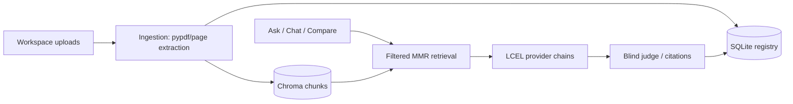

# Prompt Lab for Documents

An evidence-grounded Streamlit workspace that turns rough document questions into enhanced prompts, compares answers fairly, scores them blindly, and retains what works.

## Features

- Multi-document PDF, TXT, and Markdown ingestion with page-scoped Chroma chunks.
- Gemini (default), OpenAI, Anthropic LLMs; Gemini (`gemini-embedding-001`), OpenAI, or optional local HuggingFace embeddings.
- Structured task answers, source labels (`[S#]`), source passages, prompt diff, blind judge, chat, prompt history, analytics, and conflict detection.
- SQLite and Chroma persistence in `data/`; duplicate uploads are skipped by content hash.

## Architecture



## Data model

`documents` stores the content hash and extraction statistics. `runs` keeps prompts, serialized responses and judge output. `templates` stores reusable prompts. `chats` and `messages` store conversation history. Chroma stores chunks with `doc_id`, `doc_name`, `page`, and `chunk_index` metadata.

## Setup and run

```bash
python -m venv .venv
.venv\Scripts\activate  # Windows
pip install -r requirements.txt
copy .env.example .env
streamlit run app.py
```

Set a provider key in `.env` (`GOOGLE_API_KEY` or `GEMINI_API_KEY`, `OPENAI_API_KEY`, or `ANTHROPIC_API_KEY`) or enter one in the sidebar. The sidebar key exists only in Streamlit session memory. Anthropic requires Gemini, OpenAI, or local HuggingFace embeddings. Gemini API keys are API credentials, not Google Cloud Application Default Credentials.

For a new Gemini project, use `gemini-3.5-flash-lite` (the app default). Gemini 2.0 Flash has been shut down.

Run tests with `pytest`. They are offline and do not require provider credentials.

## How it works

The enhancer preserves your intent while adding an explicit role, approach, output format, style, and grounding rules. Original and enhanced prompts share the exact retrieved context and model settings. The judge receives randomized anonymous response positions and maps scores back to original/enhanced.

Sources are numbered only from retrieved chunks. Citation labels resolve to their document/page and expose the exact chunk. When an evidence quote is available it is conservatively fuzzy-checked against that passage; invalid source labels are flagged.

## Pages

- **Workspace**: upload, paste, select and delete documents.
- **Ask**: choose a preset/style, compare answers, judge, export and save.
- **Chat**: ongoing document Q&A with persisted messages.
- **Compare Documents**: find agreement and contradictions across 2–5 documents.
- **Prompt Library / Analytics**: reuse runs and inspect score improvements.

## Deployment and limitations

Run locally, with the included Dockerfile, Streamlit Community Cloud, or Hugging Face Spaces. Cloud/container disks can be ephemeral: mount durable storage for `data/` if you need retained documents and history. Scanned or encrypted PDFs are rejected gracefully; OCR is intentionally not included. Local HuggingFace embeddings require installing `sentence-transformers`.
